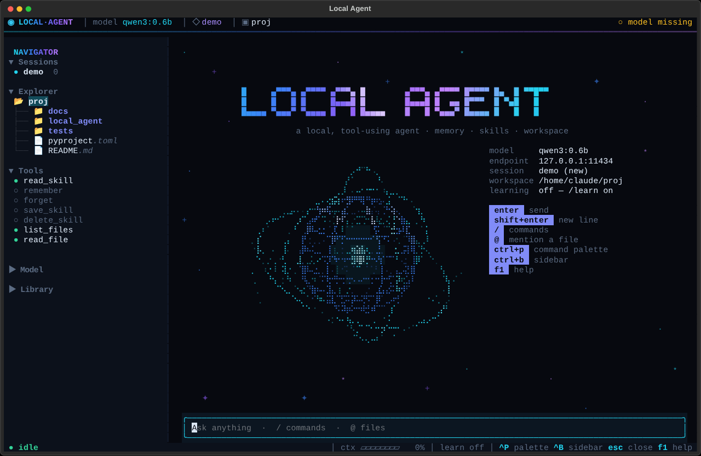
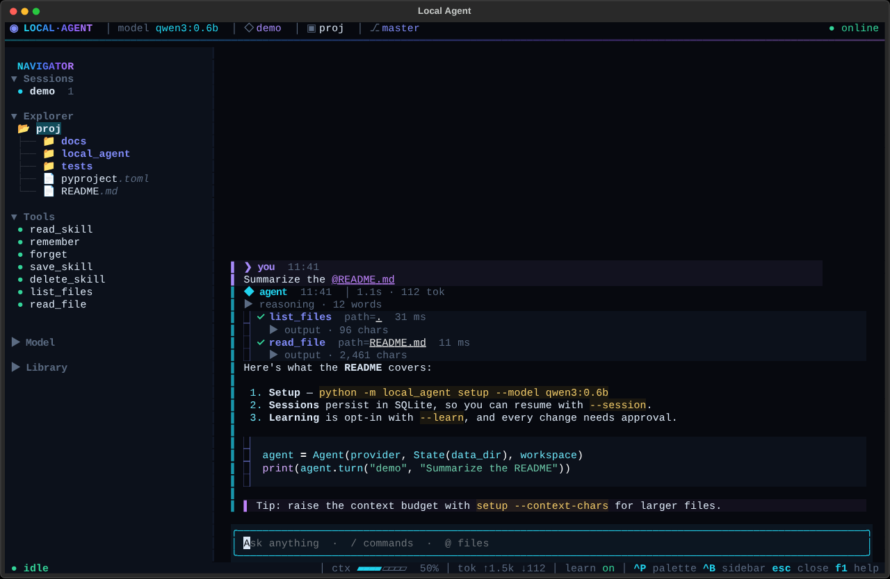
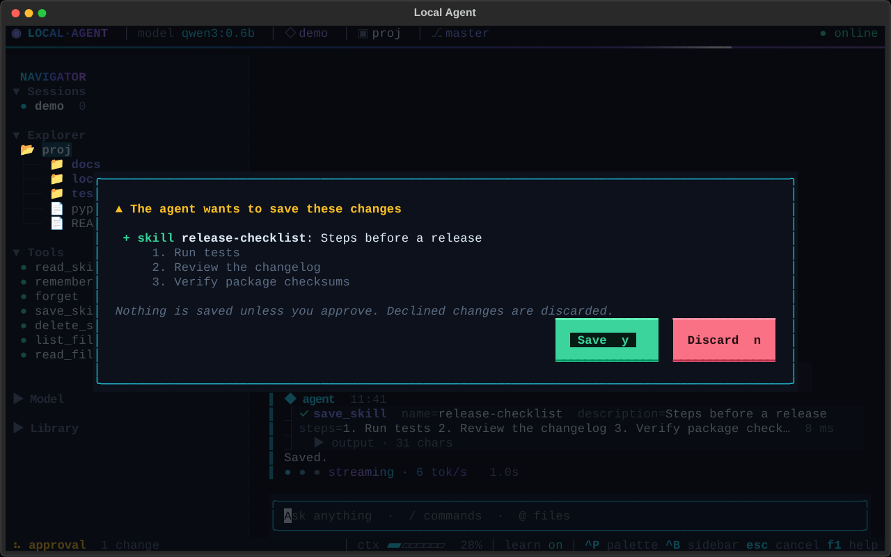
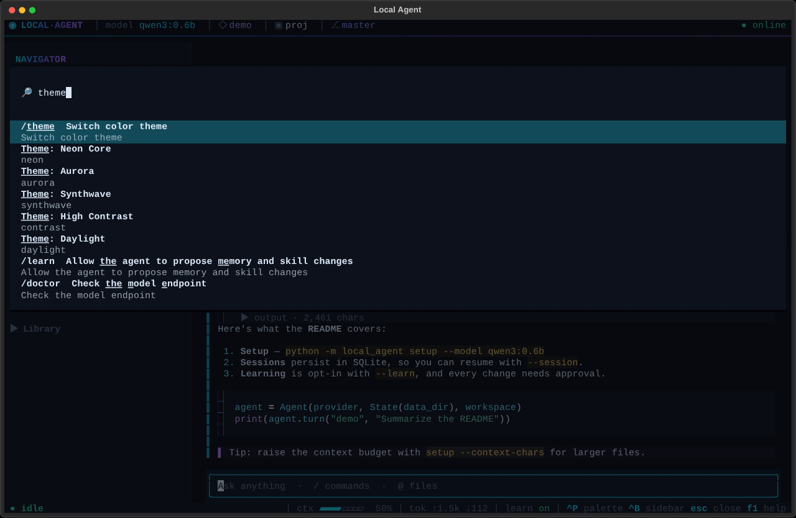
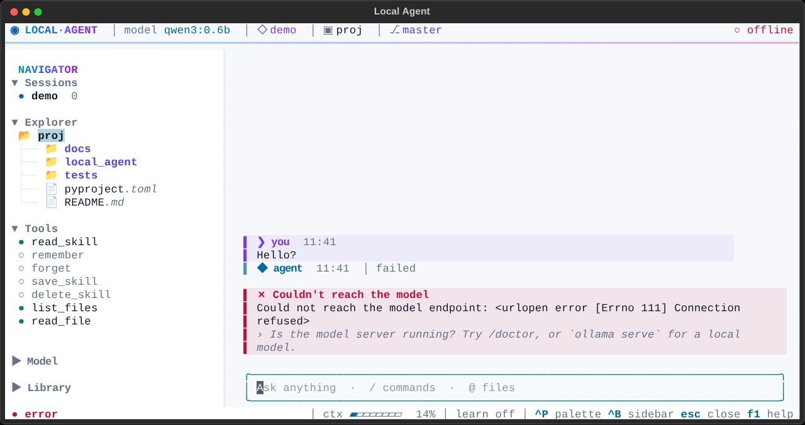
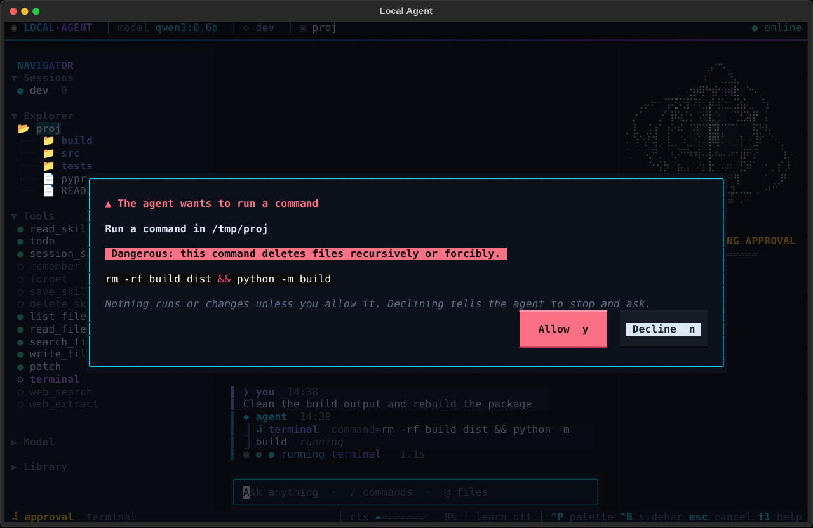

# Local Agent

A standalone Python CLI agent with persistent conversations, memory, and reusable skills. A named chat sends messages to a configured model provider, runs the tools it asks for, and passes their results back until the model replies. It can read, search and edit files, run shell commands, search the web, keep a task list, search earlier conversations, and remember facts and reusable skills. Every change to your files and every command waits for your approval. SQLite stores completed turns, task lists, memories and skills.

## Run on Windows

Requires Python 3.11 or later and a model with tool calling: local through Ollama, or a cloud model (Claude, OpenAI/Codex, DeepSeek, Alibaba Qwen and others; see [Models and settings](#models-and-settings)). Every command block in this README can be pasted into Command Prompt or PowerShell.

### Install a release

Install [Ollama](https://ollama.com/download) and start it, then download a small model with tool calling:

```powershell
ollama pull qwen3:0.6b
```

Install Local Agent with the terminal UI from the [latest release](https://github.com/Hoeur/local-agent-cli/releases/latest):

```powershell
python -m pip install "local-agent-cli[tui] @ https://github.com/Hoeur/local-agent-cli/releases/download/v0.3.3/local_agent_cli-0.3.3-py3-none-any.whl"
```

If you downloaded the wheel, install the file with `python -m pip install "local_agent_cli-0.3.3-py3-none-any.whl[tui]"` from the folder that holds it. Then open the project folder you want to work in, save the model setting, check it, and start a session there. Settings, sessions and task lists are kept in that folder's `.agent` directory.

```powershell
local-agent setup --model qwen3:0.6b
local-agent doctor
local-agent chat --session dev --workspace . --write
```

If Windows can't find `local-agent`, pip installed it into a Scripts folder that isn't on `PATH`; use `python -m local_agent` in its place. `doctor` says what to do when Ollama isn't running or the model isn't downloaded yet.

### Run from source

From this directory:

```powershell
python -m pip install -e ".[tui]"
python -m local_agent setup --model qwen3:0.6b
python -m local_agent doctor
python -m local_agent chat --session demo
python -m local_agent chat --session dev --workspace . --all
```

Use the `demo` command for basic chat or the `dev` command to enable workspace access, file edits, shell commands, web access, and learning.

To build and install a wheel from this checkout:

```powershell
python -m pip install build
python -m build --wheel
python -m pip install "dist/local_agent_cli-0.3.3-py3-none-any.whl[tui]"
```



## Tools

Tools are organized into groups. Only the groups you enable are sent to the model, so a small model sees fewer choices and the request stays small.

| Group | Enabled by | Tools | What they do |
|---|---|---|---|
| core | always | `read_skill`, `todo`, `session_search` | Load a saved skill. Keep a task list for multi-step work; it's saved with the session and shown to the model on later turns. Search earlier conversations in every session. |
| artifacts | always | `create_artifact`, `list_artifacts`, `read_artifact` | Create and browse deliverables in the agent data directory. |
| image | configured image model | `generate_image` | Generate an image artifact with an Images API endpoint. |
| learn | `--learn` | `remember`, `forget`, `save_skill`, `delete_skill` | Propose memory and skill changes, saved at the end of the turn after you approve them. |
| workspace | `--workspace DIR` | `list_files`, `read_file`, `search_files` | List folders, read files with line numbers and paging, search file contents with a regex or names with a glob. Read-only. |
| write | `--write` | `write_file`, `patch` | Create or replace a file, or replace one exact, unique piece of text in a file. You see the diff and approve each change before it's made. |
| shell | `--shell` | `terminal` | Run a command in the workspace (`cmd.exe` on Windows, `/bin/sh` elsewhere) with no input, a timeout (60 s by default, up to 600 s) and capped output. You approve each command. |
| web | `--web` | `web_search`, `web_extract` | Search DuckDuckGo and read pages as plain text. If DuckDuckGo challenges the default automated request, the result is labeled and limited to English Wikipedia. Set `AGENT_SEARCH_URL` to use your own DuckDuckGo-compatible HTML search endpoint, or opt into the Brave Search API (see [Web search providers](#web-search-providers)). |

`--all` is shorthand for `--learn --write --shell --web`. `--write` and `--shell` need `--workspace`. In the full-screen UI, `/write`, `/shell`, `/web` and `/learn` switch the groups on and off between turns.

### Approvals and safety

- **File changes and commands** are approved one at a time, before they happen. The prompt shows the diff, or the full command. If you decline, nothing changes and the model is told to stop and ask you what to do. Without a terminal to ask, every action is declined.
- **Workspace writes** show a result recorded by Local Agent alongside the model's reply. Check this result for files that were created, updated, declined, or failed. The result is saved with the session.
- **`--yes`** saves memory and skill changes and allows actions without asking, with one exception: commands that look destructive are flagged and always ask. These include recursive deletes, disk formatting, `git push --force` or `reset --hard`, piping a download into a shell, `sudo`, force-killing processes, and changes to the registry or services. The full list is `DANGEROUS` in `local_agent/tools.py`. Without a terminal to ask, flagged commands are declined. This is a safety net for mistakes, not a sandbox. A command you allow runs with your user's permissions and can reach outside the workspace.
- **File tools** stay inside the workspace. Paths must be relative, with forward slashes (backslashes are converted). Hidden files and folders such as `.git` and `.env`, Windows device names, and links that lead outside are refused. Writes go through a temporary file, so a failed write leaves the original intact. `patch` also matches text written with `\n` against files that use Windows `\r\n` line endings, and keeps the file's own line endings.
- **Web tools** fetch pages read-only and follow up to five redirects. They connect directly to checked public addresses on every hop and skip system HTTP proxies. Web content is untrusted data.
- **Prompt injection.** The system prompt tells the model to treat saved context and tool output as data, not instructions. The approval prompts are your real defense, so read what you allow.

### Context budget and compression

Each model request is kept within a character budget, 12,000 by default (roughly 3,000 to 4,000 tokens). This fits Ollama's small default context window, which otherwise drops whatever doesn't fit without warning. With every tool group enabled, the tool definitions alone take about 4,000 characters. For real work with `--all`, raise the model's window and the budget, for example by setting `OLLAMA_CONTEXT_LENGTH=16384` before starting Ollama, then `setup --model qwen3:0.6b --context-chars 48000`. `AGENT_CONTEXT_CHARS` overrides the saved budget. Running setup again resets the budget unless you pass it. Tool output scales with the budget: file reads, search results, command output and web pages each return up to a fifth of it (at least 2,400 characters).

Earlier turns are replayed within up to half of the space left after the system prompt and the new message. When a turn outgrows the budget, the agent compresses context, keeping the system prompt, your message and the newest work:

1. Tool results from earlier rounds of this turn are replaced with a short note that the model can re-run the tool.
2. The oldest replayed turns are dropped.
3. The newest tool results are shortened, keeping their structure and marking them as truncated.

The turn fails only if even that isn't enough. Reasoning blocks such as Qwen's `<think>…</think>` are stripped before a reply is saved, so they never take up space in later requests.

## Terminal UI

In an interactive terminal, `chat` opens a full-screen interface. It includes:

- an animated holographic AI core that reacts to what the agent is doing (thinking, streaming, running tools, waiting for approval, success and error)
- streamed Markdown replies with highlighted code
- live tool-call rows you can expand
- a sidebar with live CPU usage and history, RAM usage, disk free space, app memory, sessions, a file explorer, tools and model details
- a command palette (`ctrl+p`), plus `/` command and `@` file autocomplete
- approval dialogs for memory and skill changes and for each file change and command
- five themes and three motion levels

`esc` cancels a running turn, discards its conversation and staged changes, and stops a running command along with its child processes. Workspace edits already applied stay on disk. Press `f1` for every shortcut. `f3` or `/hologram` shows, hides, resizes and switches the hologram's renderer: Braille 3D, ASCII, or Sixel/Kitty graphics with `pip install -e ".[hologram-image]"`.

The UI needs the optional `tui` extra ([Textual](https://textual.textualize.io/) and `psutil`). Without Textual, or with `--plain`, or when input or output is piped, `chat` uses the line-based interface, which keeps the original output format when piped. `--no-stream` requests whole replies from providers that handle streaming poorly. The interface works in Windows Terminal, macOS Terminal, Linux terminals and over SSH, where it defaults to reduced motion. See [docs/TUI.md](docs/TUI.md) for the layout, keys, commands, design system and architecture.

The system monitor stays at the top of the sidebar and refreshes once per second without blocking chat. Its readings stay local. App RAM is the chat process's memory; separately running model servers are reflected in total system RAM. Press `ctrl+b` or `f2` to show the sidebar if it is hidden; terminals below 100 columns hide it automatically. Restart chat after updating the source so Python loads the new monitor. Reinstall `python -m pip install -e ".[tui]"` if the counters show that `psutil` is missing.

| | |
|---|---|
|  |  |
|  |  |
|  | |

## Attachments and artifacts

Attach local images or UTF-8 text with repeatable `--attach` options.

```powershell
local-agent chat --session reports --attach .\notes.txt "Summarize these notes and save report.md."
local-agent chat --session vision --max-rounds 0 --attach .\photo.png "Describe the photo."
```

Use `/attach PATH`, `/attachments`, and `/detach` in either chat interface; `/detach 2` or `/detach notes.txt` removes one file and `/detach` alone removes them all. Quote paths with spaces. The terminal UI shows queued files just above the composer, and clicking a file there removes it. Files are read at submission and sent to the active model provider. The queue clears when a turn succeeds and stays available after an error or cancellation. PNG, JPEG, WebP, and GIF inputs require a vision-capable model. Use `--max-rounds 0` for models that cannot accept tools alongside an image. The data directory caches image bytes so session history can replay them after the original file moves. Each message supports four attachments, up to 5 MB per file, 10 MB of images, and 12,000 combined text characters. Replayed images share a 10 MB per-request limit.

Ask the agent to save a UTF-8 text artifact such as `index.html`, `style.css`, `app.js`, `settings.toml`, or `Dockerfile`. Use a simple filename without directories. The file is stored under `.agent/artifacts/` or the selected `--data-dir`, with a unique ID for each version. In the terminal UI each artifact a turn creates appears under its tool call with **Preview** and **Copy path** buttons, and `/artifacts` shows the latest ten the same way. Use `/artifact ID` or `/open ID` in either chat interface, or the CLI commands below.

```powershell
local-agent artifacts
local-agent artifact ARTIFACT_ID
local-agent artifact ARTIFACT_ID --open
```

Browser previews display HTML, SVG, and generated images in a sandbox with scripts and external resources blocked. Other text artifacts show their source. A failed or cancelled turn removes artifacts created by that turn. Text artifacts support up to 24,000 characters, subject to the model context budget.

### Optional image generation

Set an image model on a chat profile to enable `generate_image`.

```powershell
local-agent setup --provider custom --base-url https://chat.example/v1 --model CHAT_MODEL --image-base-url https://images.example/v1 --image-model IMAGE_MODEL
```

The endpoint must implement `POST /images/generations` and return an inline base64 image in `data[0].b64_json` (up to 10 MB). Set `AGENT_IMAGE_API_KEY` for a separate image endpoint. With no image URL, the agent uses the chat base URL, and it only reuses the chat key when both URLs match. `AGENT_IMAGE_MODEL` and `AGENT_IMAGE_BASE_URL` override saved settings.

## Web search providers

Web tools stay off until you pass `--web` (or `--all`) or type `/web on`. Searches use DuckDuckGo by default, with no key; `AGENT_SEARCH_URL` still points that at your own DuckDuckGo-compatible HTML page. For steadier results you can switch to the [Brave Search API](https://api-dashboard.search.brave.com/app/documentation/web-search/get-started), a general web search endpoint that needs an API key:

```powershell
local-agent web-search brave
local-agent key set brave-search
local-agent web-search
```

The provider choice is saved in this folder's `.agent/config.json`. The key is not: it comes from the `BRAVE_SEARCH_API_KEY` variable, or from the same private key store as model keys (`%APPDATA%\local-agent\keys.json` on Windows). `local-agent web-search duckduckgo` switches back, and `AGENT_SEARCH_PROVIDER` picks a provider for one run. Every search result names the provider it came from, and failures say which provider failed and why: a missing or rejected key, a rate limit or quota, or no connection. The key is sent only to Brave over HTTPS, never along a redirect to another site, and Brave's results are read through the same checks as every other page, so private and local addresses stay blocked.

## Models and settings

The agent can run on a local Ollama model or on a cloud model you pay for by the token. Each saved setup is a *profile* (provider, model, endpoint and budget) in `.agent/config.json`; you can keep several and switch between them.

| Provider | `--provider` | Default model | API key variable |
|---|---|---|---|
| Ollama, on your computer | `ollama` (default) | pass `--model` | none |
| Claude (Anthropic) | `anthropic` or `claude` | `claude-sonnet-5-5` | `ANTHROPIC_API_KEY` |
| OpenAI, including Codex models | `openai` or `codex` | `gpt-5.5` | `OPENAI_API_KEY` |
| DeepSeek | `deepseek` | `deepseek-chat` | `DEEPSEEK_API_KEY` |
| Alibaba Model Studio, Singapore / Virginia / Beijing | `alibaba`, `alibaba-us`, `alibaba-cn` | `qwen3-coder-plus` | `DASHSCOPE_API_KEY` |
| Alibaba Coding Plan (monthly subscription) | `alibaba-coding` | `qwen3-coder-plus` | `DASHSCOPE_API_KEY` |
| OpenRouter (one key, many vendors) | `openrouter` | pass `--model` | `OPENROUTER_API_KEY` |
| A reseller or any other endpoint | `custom` | pass `--model` and `--base-url` | `AGENT_API_KEY` |

```powershell
python -m local_agent setup --provider deepseek
python -m local_agent key set deepseek
python -m local_agent doctor
python -m local_agent chat --workspace . --write
```

`setup` saves the profile and makes it active, `key set` asks for the key without echoing it, and `doctor` checks the key, endpoint and model. More profile commands:

| Command | What it does |
|---|---|
| `python -m local_agent setup --provider alibaba --model deepseek-v3.2` | DeepSeek served by Alibaba |
| `python -m local_agent use claude` | Switch profile (creates it from the preset) |
| `python -m local_agent use ollama --model qwen3:4b` | Switch and change that profile's model |
| `python -m local_agent --profile anthropic chat` | Use a profile once without switching |
| `python -m local_agent providers` | Presets, saved profiles, which keys are set |
| `python -m local_agent models` | Models the active endpoint offers |
| `python -m local_agent key list` | Where each key comes from (never the key) |

In the terminal UI, `/provider` lists profiles and `/provider <name>` switches; `/model` lists the endpoint's models and `/model <name>` switches model. Both take effect from the next message.

**API formats.** Ollama, DeepSeek, Alibaba, OpenRouter and most resellers use OpenAI's chat-completions format. Claude uses Anthropic's Messages API, with prompt caching on the system prompt and tool list so repeated tool rounds cost less. OpenAI uses the Responses API, which Codex models require; replies are not stored on OpenAI's servers (`store: false`). For a reseller, pick the format they document with `--wire chat|anthropic|responses`, for example `setup --provider custom --name shop --wire anthropic --base-url https://their-host/v1 --model claude-sonnet-5-5`. The base URL stops before `/chat/completions`, `/messages` or `/responses`.

**API keys** are never written to the project. The agent looks for the provider's variable first (`setx DEEPSEEK_API_KEY sk-...`, then open a new terminal), then the key store filled by `key set`, which is `%APPDATA%\local-agent\keys.json` on Windows (`~/.config/local-agent/keys.json` elsewhere; `AGENT_KEYS_FILE` overrides). The store is plain JSON readable by your user account, like most CLI credential files, so don't share that folder. `AGENT_API_KEY` is used only for Ollama and `custom` profiles, so a reseller key is never sent to Anthropic or OpenAI by mistake.

**Budgets and cost.** Cloud profiles default to a 100,000–150,000 character budget (about 25,000–40,000 tokens), because these models have large windows. Every tool round resends the conversation, so a turn with six tool rounds is billed for roughly six requests; lower `--context-chars` to spend less. Claude replies are capped at 8,192 tokens unless you pass `--max-tokens`. Hosted endpoints that are overloaded or rate-limited are retried twice; an exhausted balance or quota is reported at once, along with the provider's own error message.

`AGENT_BASE_URL`, `AGENT_MODEL`, `AGENT_CONTEXT_CHARS` and `AGENT_PROFILE` override the saved settings. For Ollama on another machine, install and start Ollama, then `ollama pull qwen3:4b` and `setup --model qwen3:4b`. Providers that omit tool-call IDs, or send empty arguments for calls that take none, are handled.

## Commands

Use `/exit` (or `ctrl+q` in the full-screen UI) to leave interactive chat, or supply one prompt on the command line. Reuse `--session` to continue a conversation. `memory` lists memories and `remember` saves one yourself; `search` looks through every conversation; `todo` prints a session's task list.

```powershell
python -m local_agent chat --session demo --learn "Remember that I prefer concise replies."
python -m local_agent chat --session demo --learn "Save a skill called release-checklist with these steps. Run tests, review the changelog, and verify package checksums."
python -m local_agent chat --session dev --workspace . --write --shell "Run the tests and fix the first failure."
python -m local_agent chat --session research --web "What changed in the latest Python release?"
python -m local_agent memory
python -m local_agent remember editor vscode
python -m local_agent forget editor
python -m local_agent skills
python -m local_agent skill release-checklist
python -m local_agent skill release-checklist --delete
python -m local_agent sessions
python -m local_agent history demo
python -m local_agent search "concise replies"
python -m local_agent todo dev
python -m local_agent delete-session demo
```

- `--learn` enables changes to memories and skills. Before saving, the CLI lists the pending changes and asks for confirmation. Declined changes are discarded, and the saved reply and tool results note that they were not saved. The model receives saved memories and a list of skill descriptions on each turn. It can request the full text of a relevant skill by name.
- `--max-rounds N` sets how many tool rounds a turn may use, from 1 to 50 (default 6). Multi-step coding tasks with `--write --shell` usually need more, for example `--max-rounds 20`. After the last round, the model is asked for a text answer with no tools available.
- Choose a workspace whose contents you are comfortable sharing with the configured provider. Chat history, memories and tool results are included in model requests as needed.
- State lives in `.agent/state.sqlite3`. Use `python -m local_agent --data-dir <directory> chat` for a separate history, memory and skill library. The database is versioned: older data directories are upgraded in place when opened, and a directory written by a newer version is refused rather than damaged.

## MVP behavior

Memory and skill changes are committed together with the completed turn, after you approve them. The task list is saved with the turn too. In the terminal UI, `/todo add`, `edit`, `move`, `start`, `done`, `undo` and `remove` change the list yourself; your edits are saved at once, and a turn that is running keeps your version rather than overwriting it (the model is shown the edited list). Provider failures, cancellation or tool-loop exhaustion discard everything the turn staged. File changes and commands you approved have already happened by then and are not undone. A concurrent update to the same session is rejected so its history stays consistent.

The MVP has these limits:

- **Store:** up to 20 memories and 20 skills per data directory, and up to 30 tasks per session.
- **Tool calls:** up to four calls per round. Extra calls in a round get an error result the model can act on.
- **Tool output:** file reads page through files of up to 5 MB, and searches scan up to 5,000 files and return up to 60 matches.
- **History:** up to 20 recent completed turns. Full transcripts remain available through `history`.

These are character limits, so keep the budget within the model's context window. The small local model has limited reasoning and instruction-following ability. Model-generated memories and skills can be inspected with the commands above.

## Install and verify

The agent and the line-based chat run directly from source using Python's standard library. The full-screen UI adds Textual and psutil through the `tui` extra. For a `local-agent` command, install the project into your Python environment.

```powershell
python -m pip install -e ".[tui]"
local-agent doctor
python -m unittest discover -s tests -v
```

Without the extra, the terminal UI tests are skipped and everything else runs. GitHub Actions runs the suite on Windows, Linux and macOS for Python 3.11 to 3.13, with and without the extra (`.github/workflows/tests.yml`). A separate job installs a freshly built wheel and checks the coding workflow on all three systems. These headless checks do not replace testing in a real terminal.

See [Release procedure](docs/RELEASING.md) for tag-triggered publishing, checksums and native terminal checks, and [Stabilization results](docs/STABILIZATION.md) for the latest local verification and remaining acceptance work.

Earlier live verification with Ollama and `qwen3:0.6b` covered these, through interactive chat:

- memory creation, and recall in another session
- skill creation, and loading the saved skill
- reading a workspace file
- session listing and transcript viewing

Windows testing with live Ollama also covered a project edit from an attachment, an approval and a decline, and session resume. The installed-wheel workflow check exercises project file creation, separate artifacts, approval outcomes, clipboard controls, and task list persistence against a scripted endpoint. Shell and web tools are covered by automated tests.

Automated regression checks cover:

- **File tools:** reads with paging, search, writes and patches with approval, and workspace boundaries.
- **Terminal and web:** exit codes, timeouts, cancellation, long output, flagged commands, page extraction, redirects, refused private addresses and search parsing.
- **Task list and search:** todo persistence and session search.
- **Context:** compression, `<think>` stripping, and context budgets.
- **Providers:** missing tool-call IDs, argument validation, and provider response parsing.
- **Storage:** schema upgrades, persistence, rollback, stale session writes, skill storage and store limits.
- **Approval and limits:** disabled learning, change approval, declined-change history, and tool limits.
- **Command line:** the memory, skill, search, todo and session commands.
- **Terminal UI:** streaming, tool rows, the approval and action dialogs, dangerous-command focus, cancellation, errors, commands, autocomplete, file previews, resizing and resumed history.
- **Streaming:** against a local HTTP endpoint.

## Design and scope

The implementation includes:

- the model/tool loop
- toolsets
- the file tools (`read_file`, `write_file`, `patch`, `search_files`)
- the `terminal` tool with dangerous-command approval
- `todo` and `session_search`
- web search and extraction
- persistent sessions and on-demand skill loading
- context compression (protect the head and the newest tail, prune old tool output first)

This project implements its own CLI, provider adapter and data format, with one deliberate difference: compression trims and drops context deterministically instead of asking a second model for a summary.

The following features are not part of this MVP:

- background processes
- browser automation
- sub-agents (`delegate_task`)
- `execute_code`
- scheduled jobs
- messaging gateways
- text-to-speech
- MCP servers
- file-based `MEMORY.md` / `USER.md` memory
