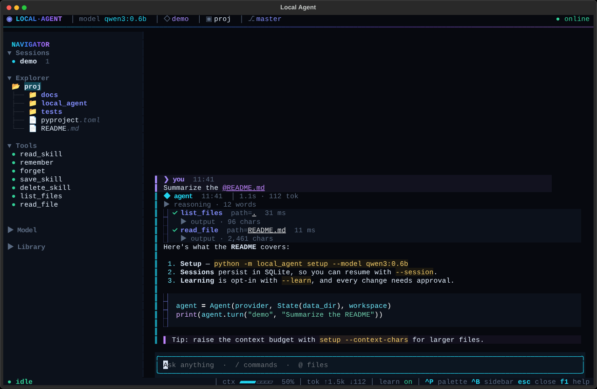
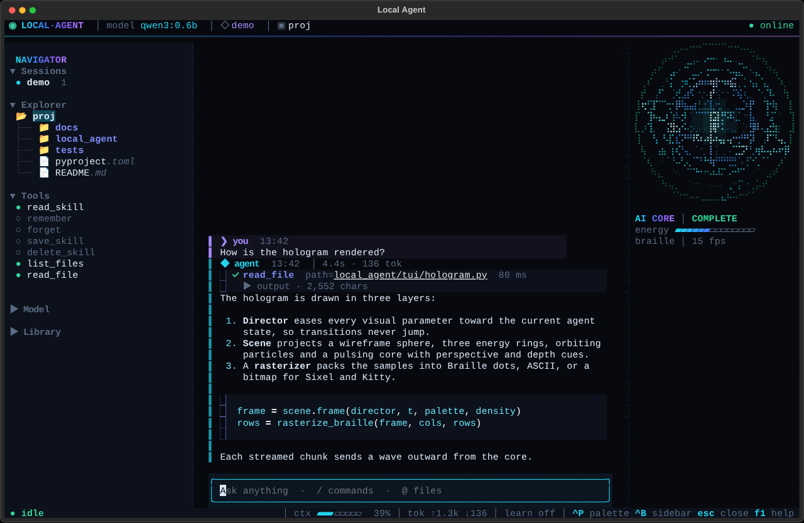
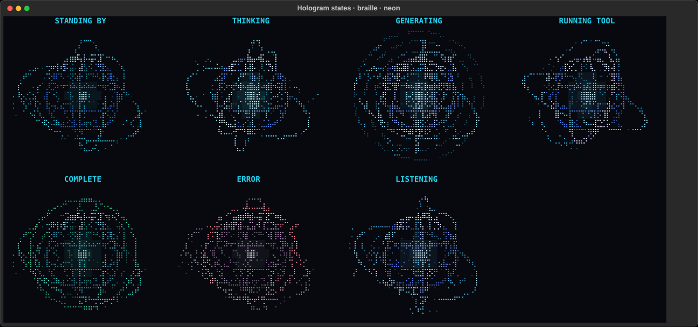

# Terminal UI

The full-screen interface for `python -m local_agent chat`. It's an optional layer over the same agent: the model/tool loop, storage, approval rules and every CLI command are unchanged, and the classic line-based chat is still there with `--plain`.



## Running it

```powershell
python -m pip install -e ".[tui]"
python -m local_agent chat --session demo --workspace . --learn
python -m local_agent chat --session dev --workspace . --all   # files, shell, web and learning
```

The full-screen UI starts when Textual is installed and both input and output are a terminal. It falls back to the line-based chat when either is piped, with `--plain`, or with `AGENT_UI=plain`. One-shot prompts (`chat "question"`) always print plain text. `--no-stream` asks the model for whole replies instead of streaming them.

## Layout

| Area | What it shows |
|---|---|
| Header | Breathing orb (it takes the hologram's state color), name, model, session, project folder, git branch, connection status (checked at start-up and by `/doctor`). A comet runs along the glow rule while the agent works. |
| Sidebar (`ctrl+b`) | Sessions (enter to switch), a project explorer (enter previews a file), which tools are enabled and which one is running, model details, saved memories and skills. Each section collapses. Width is adjustable from the palette or with `/sidebar 40`. |
| Conversation | Your messages, then each agent turn: a pulsing thinking line, collapsible reasoning (Qwen `<think>` blocks or a provider `reasoning` field), streamed Markdown with highlighted code, and one row per tool call with a spinner, result status, timing and expandable output. Workspace paths in tool rows are clickable previews. Errors appear as cards with a hint. |
| Holographic core (`f3`) | A rotating 3D hologram of the agent beside the conversation, with its state, an energy gauge and the renderer underneath. A larger one fills the welcome screen. See [Holographic core](#holographic-core). |
| Composer | Bordered, multiline, grows to 10 lines. `/` completes commands and their arguments, `@` completes workspace file names. Up and down recall earlier prompts. |
| Status bar | Agent state and current step, a context-budget gauge for the last request, token counts (exact when the provider reports usage, `~` estimated otherwise), learning on/off, and key hints. |
| Overlays | Command palette (`ctrl+p`), approval dialog for memory and skill changes, action dialog for file changes and commands (shows the diff or the command; dangerous commands are marked and start on **Decline**), file preview, help (`f1`). |

## Keyboard

| Key | Action |
|---|---|
| `enter` | Send |
| `shift+enter`, `ctrl+j` | New line (`ctrl+j` works in every terminal) |
| `tab` / `enter` | Accept a suggestion · `esc` dismisses it |
| `ctrl+p` | Command palette |
| `ctrl+b`, `f2` | Toggle the sidebar |
| `ctrl+o` | Expand or collapse all tool output |
| `pageup` / `pagedown`, `ctrl+home` / `ctrl+end` | Scroll the conversation |
| `esc`, `ctrl+c` | Cancel the running turn |
| `f3` | Show or hide the hologram |
| `alt+←` `alt+→` `alt+↑` `alt+↓` | Rotate and tilt the hologram (also: drag it with the mouse; the wheel zooms) |
| `ctrl+t` | Next theme |
| `ctrl+n` | New session |
| `ctrl+l` | Clear the view (the saved history is untouched) |
| `ctrl+q`, `/exit`, `ctrl+d` on an empty composer | Quit |

## Commands

`/help`, `/new [name]`, `/session <name>`, `/sessions`, `/history` (the view shows the latest 40 turns; this loads all), `/clear`, `/memory`, `/forget <name>`, `/skills`, `/skill <name>`, `/todo` (this session's task list), `/search <words>` (past conversations), `/learn [on|off]`, `/write [on|off]` and `/shell [on|off]` (need `--workspace`), `/web [on|off]`, `/theme [name]`, `/motion [full|reduced|off]`, `/sidebar [on|off|width]`, `/hologram [...]` (see below), `/expand`, `/doctor`, `/provider [name]` (list or switch model profiles: Claude, OpenAI, DeepSeek, Alibaba...), `/model [name]` (list or switch the model), `/copy` (last reply, via the terminal clipboard), `/exit`. Every command without an argument is also in the palette, along with session switching, saved provider profiles, themes and motion levels.

## Holographic core



A wireframe sphere with perspective and depth cues (the far side is dimmer and dotted), three energy rings that precess on their own axes with dashes flowing along them, particles on inclined orbits with fading trails, a pulsing core with a soft glow, and a scanning band of light. It is driven by the agent's real events, not a timer:

| Agent event | Hologram |
|---|---|
| Idle | Slow rotation and a gentle breathing pulse. |
| Request sent, reasoning streamed | **Thinking**: faster spin, particles spiral into the core, brighter energy. |
| Answer text streamed | **Generating**: each streamed batch sends a wave outward from the core (its size follows the batch), and the wireframe ripples. |
| Tool call | **Tool**: rings speed up and the inner ring becomes a progress arc: finished calls in this round, plus an easing estimate for the running one. A failed call glitches briefly. |
| Approval dialog open | **Waiting**: slows down and tints amber. |
| Turn completed | **Success**: an expanding green pulse, then idle. |
| Turn failed | **Error**: a red pulse with tearing distortion, then idle. |
| Audio levels arrive | **Voice**: the sphere and particles move with the level. Nothing in this app produces audio yet; `AgentApp.set_audio_level(level)` is the hook (thread-safe, non-blocking) for a future microphone or text-to-speech feature. Voice mode never runs on simulated data. |

Every transition eases over about 0.3 s: each visual parameter (spin, energy, particle convergence, ring speed, tint) moves toward its target for the new state, and rotation is integrated, so speed changes never make the sphere jump.



### Renderers

| Renderer | When | How |
|---|---|---|
| `braille` (enhanced 3D) | Default on any Unicode terminal | Each cell holds a 2 × 4 grid of Braille dots, so sub-pixels are square and the sphere is round. True-color brightness per cell, depth cues and a background glow behind the core. |
| `ascii` (universal fallback) | Classic Windows console, Linux virtual console (`TERM=linux`), `TERM=dumb`, or chosen | One sample per cell, ASCII characters only (`.:-=+*#%@`), same scene and states. |
| `image` (high fidelity, optional) | Chosen with `/hologram image` on a terminal that reports Sixel or Kitty graphics | A Pillow bitmap with bloom, sent through `textual-image`. Needs `pip install -e ".[hologram-image]"`. |

`auto` picks `braille` or `ascii`. It never picks `image` by itself, because encoding a bitmap every frame costs far more than text (about 15 ms to draw plus 40–60 ms to Sixel-encode per frame here), so image mode is capped at 12 fps and usually settles around 5–8. Terminals only answer graphics queries before the UI takes over, so the probe runs at start-up and only when image mode is saved or `AGENT_HOLOGRAM=image` is set. Choosing `image` mid-session saves the choice and explains that a restart is needed. If the probe finds no support, or the image renderer fails at run time, the hologram falls back to text with a notice; graphics problems never stop the chat.

**OpenTUI and `@opentui/three`** were checked again (version 0.8.2): both require the Bun runtime (`engines: bun >= 1.3.14`) and load a native renderer through Bun's FFI, so they cannot run inside this Python process. The Braille renderer is the in-process equivalent: real perspective projection and depth, with no GPU, no WebGPU and no second runtime.

### Controls

`/hologram` toggles it (also `f3`). Arguments: `on`, `off`; `auto`, `braille`, `ascii`, `image`; `small`, `medium`, `large` or a width from 18 to 48 columns; `still` (hold still but keep the state colors) and `live`; `reset` (rotation and zoom); `status` (renderer and why it was chosen, color depth, image-protocol probe, size, target and measured fps, and milliseconds per frame). Choices are saved in `.agent/ui.json`; `AGENT_HOLOGRAM=auto|braille|ascii|image` overrides the saved renderer. Drag the hologram to rotate it (it never takes focus from the composer); a released drag coasts and settles. The wheel zooms.

### Layout

- The welcome screen shows the large hologram beside the session card, or above it when that gives more room. It shrinks with the terminal and hides below about 15 columns by 7 rows.
- In a conversation the compact hologram docks on the right. It shrinks before it hides, and it always leaves at least 58 columns for the conversation; the sidebar is counted whether it is pinned or opened as an overlay.
- When it does not fit, the header orb still shows the state color.

### Performance

- **Frame rate.** 30 fps while the agent is active, 10 fps when idle (idle motion moves less than one dot per frame at that rate), 5 fps while the terminal window is in the background (Textual's focus events), 4 fps at reduced motion. The shared clock ticks only as fast as the fastest subscriber needs.
- **Adaptive governor.** Each view measures what its frames cost and how late they arrive. Frames that cost more than a third of their slot, or keep arriving late because the event loop is busy, step the rate down within three frames; two calm seconds step it back up. While a long reply streams and re-renders Markdown, the hologram backs off (to 8–10 fps in the test below) rather than slowing the stream.
- **Redraws.** Only rows that changed are sent. Cells are merged into the longest same-style runs (blank cells join their neighbor's run), because terminals receive a color escape per run, and those escapes, not the characters, are most of the traffic.
- **Suspension.** A hidden hologram (`f3`, `/hologram off`, too small, behind the welcome screen) leaves the animation clock entirely. With `/motion off` no timer runs at all.
- **Cost.** About 3 ms per frame for the 30 × 14 side panel in pure Python (no NumPy), or about 9 % of one core at 30 fps and 3 % idle. Streaming a 6,400-character reply took 5.1 s with the hologram off and 5.4–5.7 s with it on.

## Behavior that matches the CLI

- Turns run exactly as before: `Agent.turn` with the same tools, limits and context budget. Nothing is saved until the turn completes.
- Memory and skill changes still need approval. The dialog lists each staged change; `y` saves, `n` or `esc` discards and the reply notes it. `--yes` saves without asking, as in the CLI.
- File changes and commands (`--write`, `--shell`) are approved one at a time, before they happen, in the action dialog. `y` allows, `n` or `esc` declines and the agent is told to stop and ask. With `--yes` they run without asking, except commands flagged as dangerous, which always open the dialog. While a command runs, `esc` stops it and its whole process tree.
- When a turn outgrows the context budget, older tool output is trimmed and old turns are dropped (see the README), and a "Context compressed" notice appears once per turn.
- Cancelling (`esc`) stops the turn at the next event from the agent and saves nothing. The view returns to idle immediately, even if the model is still thinking; the abandoned request finishes in the background and is discarded.
- Switching session, toggling learning and `/history` wait for an idle agent.

## Design system

**Palettes.** Five themes, each defining the Textual theme colors plus effect colors: a four-stop gradient (logo, header rule, orb), a user color, an assistant color and a muted color. All UI styling refers to theme variables, so a theme change restyles everything at once.

| Theme | Character |
|---|---|
| `neon` (default) | Near-black blue background, cyan → blue → violet → orchid |
| `aurora` | Teal and sky with magenta accents |
| `synthwave` | Deep purple with pink and cyan |
| `contrast` | Pure black and white with saturated accents, for low vision and projectors |
| `daylight` | Light background for bright rooms |

**Hierarchy.** Messages use a 1-cell colored left rule as their identity: violet for you, cyan for the agent, a muted blue for tool rows, red for errors. Headers are bold in the role color with a muted timestamp and metadata. Secondary information (timing, counts, hints) is always the muted color. Spacing uses 0, 1 or 2 cells only.

**Glyphs.** A Unicode set (braille spinner, `◉ ◆ ❯ ✓ ✗ ⎇`, `▰▱` gauges) and an ASCII set for fonts that lack them. ASCII is chosen automatically on the classic Windows console (no `WT_SESSION`), or with `AGENT_UI_GLYPHS=ascii`.

**Motion.** Three levels, saved in `.agent/ui.json` and switchable live with `/motion`:

| Level | What moves |
|---|---|
| `full` | Everything: logo shimmer, the hologram (10 fps idle, up to 30 fps while the agent works), breathing header orb, header comet, wave dots, spinners. Fade when switching sessions, slide for the sidebar. |
| `reduced` | Status spinners only, at 4 fps; the hologram holds still while idle and animates slowly only as a status indicator while the agent works. No shimmer, slides or fades. Default over SSH. |
| `off` | Nothing moves. The hologram is a still frame that still changes color with the state; state is also shown in text (`thinking`, `running read_file`). |

`AGENT_UI_MOTION` overrides the saved level, and `TEXTUAL_ANIMATIONS=none` maps to `off`. `NO_COLOR` is honored by Textual.

## Architecture

```
local_agent/
  agent.py      Agent(on_event=...) reports request/text/reply/tool_start/tool_end/commit/done
  provider.py   complete(..., on_text=...) streams via server-sent events, falls back to one request
  plain.py      line-based chat: spinner on stderr, colors only on a terminal, Ctrl+C cancels a turn
  tui/
    app.py      layout, keys, commands, the turn thread and the event bridge
    widgets.py  header, welcome, messages, tool rows, composer, sidebar, status bar
    screens.py  approval, file preview, help
    commands.py slash commands and the palette provider
    hologram.py the holographic core engine: state director, 3D scene, Braille/ASCII/bitmap rasterizers,
                frame-rate governor, renderer detection (pure Python, no Textual imports)
    holoview.py HologramView (the reusable renderer widget), HologramImage, the side panel and its HUD
    effects.py  gradients, block logo, ray-cast orb, particles, gauges (pure functions)
    theme.py    palettes, glyph sets, motion levels, saved preferences
    app.tcss    all styling
```

The agent knows nothing about the UI. The hooks are optional keyword arguments, so existing callers and tests are untouched:

1. The app runs `Agent.turn` on a daemon thread with an `on_event` callback.
2. Events are posted to the UI thread as messages, preserving their order. Streamed text is coalesced into batches, so however fast a model streams, the UI processes at most one pending batch and keystrokes never wait behind hundreds of tiny updates.
3. Approval requests travel through the same ordered queue and block the turn thread until you answer.
4. Cancelling marks the turn's token; the callback raises `TurnCancelled` at the next event, which unwinds the turn before `commit_turn` runs.

Streaming uses the Chat Completions `stream: true` format, including incremental tool-call deltas and optional usage. If an endpoint rejects it (HTTP 400, 404, 415, 422 or 501), the provider retries the same request without streaming and stops asking for the rest of the session. The reconstructed reply is validated by the same parser as a normal response.

### Rendering cost

One shared clock drives all animation and stops whenever nothing is animating. Each animated element is its own small widget with its own frame rate, so only those cells are repainted: the header orb is 3 cells, the logo 3 rows, the side-panel hologram 30 × 14.

Terminal output, measured by running `python -m local_agent chat` in a pseudo-terminal at 120 × 36 (`TERM=xterm-256color`, `COLORTERM=truecolor`) and counting bytes for 6 seconds after a 2-second warm-up. The first column is the version before the hologram, measured the same way:

| | before, full | full | reduced | off |
|---|---|---|---|---|
| Welcome screen | 88 KB/s | 103 KB/s | < 1 KB/s | < 1 KB/s |
| Idle conversation | < 1 KB/s | 34 KB/s (`ascii`: 29) | < 1 KB/s | < 1 KB/s |

Over SSH the default is reduced motion, so an idle remote session sends under 1 KB/s.

While streaming a long, code-heavy reply at about 300 tokens per second, keystrokes still reached the composer in about 60 ms on average.

## Advanced graphics: what was evaluated

| Option | Decision |
|---|---|
| **OpenTUI** (Zig renderer, TypeScript API) | Not adopted. It requires the Bun runtime and a TypeScript application; there is no Python binding. Using it would mean rewriting this Python agent or running a second process over IPC, which the gain in rendering speed does not justify for a chat UI. |
| **Kitty graphics protocol / Sixel** | Used only by the hologram's optional `image` renderer, through `textual-image`, after a start-up probe confirms support. Never chosen automatically: Windows Terminal (Sixel) and Kitty/WezTerm/Ghostty can show it, macOS Terminal cannot, and per-frame encoding is expensive. |
| **True color** | Used. Effects are computed in 24-bit color; Textual detects the terminal's color depth and downgrades to 256 or 16 colors automatically. |
| **3D / GPU (Three.js)** | Not applicable inside a terminal. The hologram is the terminal-native equivalent: a perspective-projected 3D scene rasterized into Braille sub-pixels, with depth cues, at up to 30 fps on the CPU. It works over SSH. |

## Small and unusual terminals

- Below 100 columns the sidebar hides; `ctrl+b` opens it as an overlay and `esc` closes it.
- Below 64 × 18, padding tightens and header segments drop in priority order (branch, project, then right-hand status details).
- The welcome screen shrinks the hologram, then drops it and the info card, then switches to a one-line logo as space shrinks.
- The side-panel hologram shrinks, then hides, so the conversation keeps at least 58 columns.
- The Linux virtual console (`TERM=linux`) and `TERM=dumb` get the ASCII hologram.
- On a classic Windows console, colors are downgraded and glyphs switch to ASCII.

## Testing

`python -m unittest discover -s tests -v` runs everything. With Textual installed, `tests/test_tui.py` drives the app headlessly: streaming and saving a turn, tool rows, cancelling mid-turn with input still live, approving and declining changes, error cards, non-streaming providers, slash commands, autocomplete and multiline input, file mentions and previews (including a path outside the workspace), terminal resizing, and resuming saved history. `tests/test_hologram.py` covers the hologram engine without a terminal: eased transitions, flashes, wave merging, tool progress, voice mode, projection bounds, Braille and pure-ASCII output at several sizes and in every theme, the bitmap renderer, the frame-rate governor and renderer detection. The hologram app tests follow real turns (thinking, tool, generating, success, error), `/hologram` and its arguments, `f3`, the layout at several terminal sizes, motion levels, audio levels from another thread, and the image renderer with its run-time fallback (when `textual-image` is installed). `tests/test_events.py` covers streaming against a real local HTTP endpoint (including fallback and truncated streams), the event order, cancellation, and the unchanged piped CLI output.
